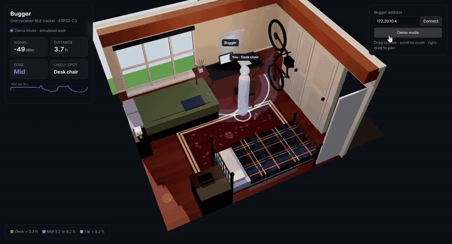

# Bugger: Bluetooth room tracker from one ESP32

Full-quality clip: [docs/demo.mp4](docs/demo.mp4)

One ESP32-C3 on a desk listens for my iPhone's Bluetooth signal and estimates where I am in my room. A 3D dashboard shows the room, the receiver, and a live estimate of my position.

One receiver can only measure distance, not direction. The project gets position by combining that distance with a model of the room: walls, furniture, the places I spend time, and how fast a person can walk. A particle filter does the combining.

## Hardware

| Part | Notes |
|---|---|
| ESP32-C3-DevKit-RUST-1 | ESP32-C3-MINI-1, native USB, WS2812 LED, SHTC3, ICM-42670 IMU |
| iPhone | Tracked through its Identity Resolving Key (IRK), no app needed |

The receiver is mounted on the wall in front of the desk, about 4 ft up. `docs/math.md` explains the placement.

## Layout

| Path | What it is |
|---|---|
| `firmware/bugger.yaml` | ESPHome firmware: BLE scan, RSSI filter, distance, zone LED, live web events |
| `firmware/irk-capture.yaml` | One-time firmware to get the iPhone's IRK |
| `firmware/secrets.example.yaml` | Template for Wi-Fi and the IRK |
| `room/room.json` | Room, furniture, receiver, calibration, and likely spots, in feet |
| `dashboard/` | 3D dashboard (Three.js, bundled in `vendor/`, works offline) |
| `docs/irk-capture.md` | IRK steps |
| `docs/math.md` | Path-loss model, ring geometry, receiver placement |

## Status

| Phase | Work | State |
|---|---|---|
| 1 | Firmware, IRK capture, live RSSI | Done |
| 2 | Calibrate A and n in the room | Done: A = −47.5 dBm, n = 3.2, 2.5 dB RMS |
| 3 | 3D room in Three.js, live distance ring | Done |
| 4 | Particle filter in the browser | First version: tracks desk, bed, doors; still mixes up the SE and SW corners when you stand still with the signal blocked |
| 5 | Demo video and write-up | Planned |

## Quick start

    pip install esphome
    cp firmware/secrets.example.yaml firmware/secrets.yaml   # fill in Wi-Fi
    esphome run firmware/irk-capture.yaml                    # see docs/irk-capture.md
    esphome run firmware/bugger.yaml

Then open `http://bugger.local`. The LED turns green at the desk, blue mid-room, purple on the far side, and dim red when the phone isn't seen.

## Dashboard

From the repo root, with the laptop on the same network as the bugger:

    python -m http.server 8000

Open `http://localhost:8000/dashboard/`. It connects to the bugger's live event stream at the address in the top-right box. If no bugger answers within 7 seconds it switches to demo mode, which simulates a walk through the room with the same noise and filter as the real board. Add `?demo` to the URL to start in demo mode.

The glowing ring is every spot at the measured distance. The faint band around it is one standard deviation of the calibration error (2.7 dB, about ±20 % in distance). The dots are a particle filter: 700 guesses that each take a random step every second and get re-weighted by how well they explain the signal. Because guesses can only walk, not jump, the filter remembers which side of the room you came from, which one distance reading can't tell on its own. The figure stands at the densest cluster.
